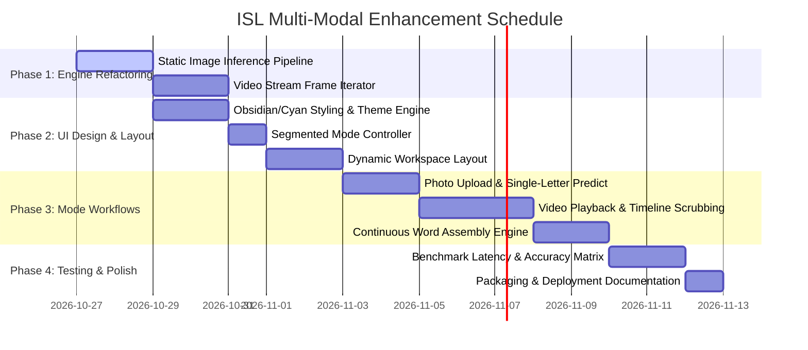

# Multi-Modal ISL Recognition Implementation Schedule
## Photo, Video, and Webcam Integration with Modernized UI Design System

---

## 1. Executive Summary & Objective

This document defines the comprehensive architecture and step-by-step implementation roadmap for expanding the Indian Sign Language (ISL) Recognition System from a webcam-only tool into a **unified Multi-Modal Recognition Platform**:

1. **📸 Photo to Letter/Sign Mode**: One-shot offline classification of high-resolution images (`.jpg`, `.png`, `.jpeg`, `.webp`).
2. **🎥 Video to Word/Sentence Mode**: Temporal analysis of uploaded video recordings (`.mp4`, `.avi`, `.mov`) with timeline scrubbing, automated keyframe isolation, and continuous fingerspelling word assembly.
3. **📹 Live Webcam Mode**: Low-latency, real-time recognition with rolling stability filters and live fingerspelling accumulator.

---

## 2. Technical Feasibility & Performance Benchmark

| Characteristic | 📸 Photo Mode | 🎥 Video Mode | 📹 Live Webcam Mode |
| :--- | :--- | :--- | :--- |
| **Model Gating** | Static MediaPipe (`static_image_mode=True`) | Stream MediaPipe (`static_image_mode=False`) | Real-time tracking pipeline |
| **Input Shape** | Arbitrary dimensions $\rightarrow$ Tight Hand ROI $\rightarrow$ 64×64 Canny | Sequential decoded video frames (subsampled 15–30 FPS) | Hardware camera resolution (default 640×480 @ 30 FPS) |
| **Latency / Efficiency** | **~25–45 ms** one-off burst; 0% idle CPU | **~10–18 ms** per frame; can process batch at up to 100+ FPS | **~22–35 ms** continuous; steady ~30% CPU / GPU load |
| **Recognition Target** | **Single Letter / Digit** (instantaneous sign) | **Fingerspelled Words & Sentences** | **Interactive Words & Sentences** |
| **Accuracy Potential** | Highest single-frame fidelity | **Highest overall accuracy** (temporal multi-frame consensus) | High with stability hold (~1.2s per character) |

---

## 3. UI/UX Design System: "Obsidian Slate & Electric Cyan"

To ensure the interface looks modern, clean, and distinct from default Tkinter styling, we establish a dedicated design system.

### 3.1 Color Palette

```
Canvas / Window:        #0B0F19  (Obsidian Deep Navy)
Card / Surface:         #131B2E  (Slate Blue-Gray)
Card Accent / Border:   #23304B  (Deep Cobalt Stroke)
Primary Glow / Brand:   #00E5FF  (Electric Cyan)
Secondary Accent:       #6366F1  (Royal Indigo)
Success / Confidence:   #10B981  (Emerald Mint)
Warning / Low Conf:     #F59E0B  (Amber)
Critical / Stop / Exit: #F43F5E  (Rose Red)
Text Primary:           #F8FAFC  (Pure Ice White)
Text Muted / Subtitle:  #94A3B8  (Slate Fog)
```

### 3.2 Typography Hierarchy

- **Title / Header**: `Segoe UI Variable Display` (Fallback: `Inter`, `Segoe UI`), 16pt, Bold.
- **Section Headers**: `Segoe UI`, 11pt, Semibold, Uppercase tracking.
- **Live Output Display**: `Consolas` / `Segoe UI Variable Text`, 28pt, Bold, Electric Cyan.
- **Telemetry & Confidence**: `Consolas`, 10pt, Mint Green.
- **Buttons & Chips**: `Segoe UI`, 10pt, Semibold.

### 3.3 Visual Wireframe

```
+=============================================================================================+
| [ISL LOGO] INDIAN SIGN LANGUAGE AI SYSTEM            [STATUS: READY] [ENGINE: COMBINED-CNN] |
+=============================================================================================+
| MODE SELECTOR:                                                                              |
|  [ 📹 Live Webcam ]     [ 📸 Photo Mode (Letter) ]     [ 🎥 Video Mode (Word/Sentence) ]    |
+---------------------------------------------------------------------------------------------+
| ACTIVE WORKSPACE                                            | TELEMETRY & CONTROLS          |
| +---------------------------------------------------------+ | +---------------------------+ |
| |                                                         | | | RECOGNITION OUTPUT        | |
| |                                                         | | | Current Sign:             | |
| |                      CANVAS VIEWPORT                    | | |   [   A   ] (98.4%)       | |
| |          (Video / Camera / Uploaded Photo)              | | |                           | |
| |                                                         | | | Assembled Text:           | |
| |  [Hand Skeleton]              [PiP: 64x64 Canny Inset]  | | |   "NAMASTE INDIA"         | |
| |                                                         | | +---------------------------+ |
| +---------------------------------------------------------+ | | MODE CONTROLS             | |
|  [ < Rewind ]  [ ▶ Play / Pause ]  [ ■ Stop ]  [ ⏩ Scrub ]  | |  [Browse File / Open Cam] | |
|  Timeline: [====●=============================] 01:24/03:10 | |  [Clear] [Backspace] [Copy]| |
+=============================================================================================+
```

---

## 4. Architectural Separation: Letter vs. Word Processing

### 4.1 Photo Mode: Single Letter/Digit Focus
- **Mechanism**: Reads input file via `cv2.imdecode(np.fromfile(...))` (to handle Unicode file paths on Windows).
- **Execution**: Evaluates hand bounding box with `static_image_mode=True`, renders landmark skeleton, generates 64×64 Canny ROI, and outputs:
  - Top-1 Predicted Class (e.g., `Letter 'K'`)
  - Top-3 Confidence Distribution
  - Inference Latency (ms)

### 4.2 Video & Webcam Mode: Word Accumulation Focus
- **Fingerspelling Pipeline**:
  1. **Frame Prediction**: Compute instantaneous class $C_t$ with confidence $P_t$.
  2. **Temporal Window**: Maintain rolling queue ($W = 5$ frames). Confirm majority agreement.
  3. **Hold-Duration Gating**: Trigger character append only if sign is stably maintained for $\ge 1.0$ second.
  4. **Word Boundary Detection**: If hands drop below frame threshold or no hand is detected for $\ge 1.5$ seconds, append a space character `' '`.
  5. **Text Auto-Refinement**: Provide real-time string output buffer with Backspace, Clear, and Clipboard Copy.

---

## 5. Step-by-Step Implementation Schedule



### Phase 1: Inference Engine Refactoring (`src/inference.py`)
- [ ] **Task 1.1**: Add `predict_image(image_bgr: np.ndarray) -> dict` to `ISLInferenceEngine`.
  - Runs MediaPipe with static mode fallback.
  - Returns bounding boxes, annotated frame, Canny ROI, class label, and confidence.
- [ ] **Task 1.2**: Add `process_video_file(video_path: str, frame_callback, completion_callback)`.
  - Background daemon thread reading frame-by-frame.
  - Emits real-time progress percentage, FPS, and aggregated text tokens.

### Phase 2: UI Styling & Dynamic Mode Controller (`src/ui_app.py`)
- [ ] **Task 2.1**: Implement custom ttk style dictionary with `#0B0F19` base, `#131B2E` panels, and `#00E5FF` active states.
- [ ] **Task 2.2**: Build top segmented mode switcher (`Webcam`, `Photo`, `Video`).
- [ ] **Task 2.3**: Implement dynamic context control panels:
  - If **Webcam**: Camera index selector, Start/Stop toggle.
  - If **Photo**: "Browse Image", "Paste from Clipboard", "Run Analysis".
  - If **Video**: "Browse Video", Play/Pause, Replay, Video Timeline Slider.

### Phase 3: Mode Workflows & Word Assembly
- [ ] **Task 3.1**: Build Photo Workflow: Drag/Drop or File Picker dialog $\rightarrow$ Render on main canvas $\rightarrow$ Display prediction badge.
- [ ] **Task 3.2**: Build Video Workflow: Threaded `cv2.VideoCapture` player $\rightarrow$ Synced timeline progress bar $\rightarrow$ Display cumulative transcribed words.
- [ ] **Task 3.3**: Connect Fingerspelling buffer: Stability timer bar, Backspace, Space, Clear, and Copy buttons.

### Phase 4: Validation & Quality Assurance
- [ ] **Task 4.1**: Test with test images across different lighting conditions and hands.
- [ ] **Task 4.2**: Verify video decoding with `.mp4`, `.avi`, and `.mov` formats.
- [ ] **Task 4.3**: Benchmark memory consumption and ensure zero memory leaks during prolonged video analysis.

---

## 6. Deliverable File Artifacts

1. `src/inference.py` — Upgraded inference engine supporting static images, video files, and camera streams.
2. `src/ui_app.py` — Upgraded desktop application featuring the Obsidian/Cyan theme and 3-mode switcher.
3. `reports/multimodal_verification_report.md` — Test evidence validating Photo, Video, and Webcam inference.
