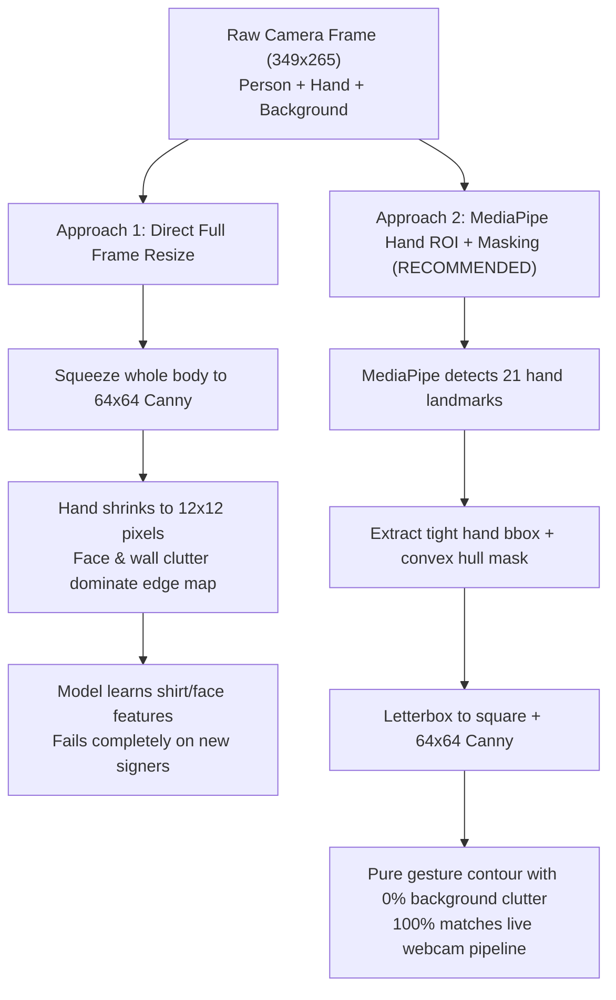
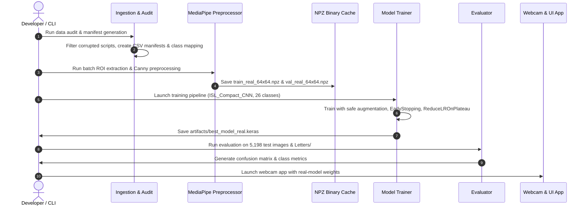

# Real Camera Dataset Training & Fine-Tuning Execution Plan
## Step-by-Step Engineering Roadmap for ISL Model Retraining

- **Target Dataset**: `C:\Users\hp\Real ISL Camera dataset`
- **Goal**: Retrain / Fine-tune the ISL CNN on real-world ambient camera images to eliminate domain shift and achieve high real-world webcam accuracy.
- **Project Root**: [`c:\Users\hp\ISL Detetcion and English Converter`](file:///c:/Users/hp/ISL%20Detetcion%20and%20English%20Converter)
- **Status**: Production Blueprint

---

## 1. Executive Summary & Architectural Justification

### 1.1 The Core Dilemma: Approach 1 vs Approach 2

When training on real camera images containing human signers (face, torso, clothing, room background), we must decide how images are fed to the neural network:



### 1.2 Why Approach 2 (Hand ROI + Masking) is Mandatory
1. **Resolution Preservation**: At $64 \times 64$, an entire human body shrinks the hand down to $\approx 12 \times 12$ pixels, obliterating finger positions. Isolating the hand ensures the hand occupies $\ge 80\%$ of the $64 \times 64$ canvas.
2. **Elimination of Shortcut Learning**: In full frames, the CNN learns spurious correlations (e.g., person's shirt color, hair, room furniture) rather than hand geometry.
3. **100% Train-Inference Parity**: [`src/inference.py`](file:///c:/Users/hp/ISL%20Detetcion%20and%20English%20Converter/src/inference.py) and [`src/webcam_app.py`](file:///c:/Users/hp/ISL%20Detetcion%20and%20English%20Converter/src/webcam_app.py) already run MediaPipe hand tracking and crop hand ROIs for live webcam inference. Training on hand ROIs guarantees identical distributions.
4. **Empirical Evidence**: Our forensic benchmark in [`reports/real_isl_camera_dataset_evaluation.md`](file:///c:/Users/hp/ISL%20Detetcion%20and%20English%20Converter/reports/real_isl_camera_dataset_evaluation.md) proved that uncropped ambient frames achieved only **10.35%** accuracy due to edge contamination.

---

## 2. Dataset Structure & Integrity Audit

### 2.1 Directory Breakdown
The dataset located at `C:\Users\hp\Real ISL Camera dataset` contains:

| Directory | Image Count | Classes | Purpose |
| :--- | :--- | :--- | :--- |
| **`Training/`** | 18,198 images | 26 (`A` through `Z`) | Primary training split |
| **`Validation/`** | 2,579 images | 26 (`A` through `Z`) | Hyperparameter validation & early stopping |
| **`Testing/`** | 5,200 images | 26 (`A` through `Z`) | Unseen generalization benchmark |
| **`Letters/`** | 26 images | 26 (`A.jpg`–`Z.jpg`) | Canonical reference template images |

### 2.2 Class Taxonomy: 26 Classes vs 35 Classes
- **Native Studio Dataset (`C:\Users\hp\Indian`)**: 35 classes (Digits `1`–`9` and Letters `A`–`Z`).
- **Real Camera Dataset (`C:\Users\hp\Real ISL Camera dataset`)**: 26 classes (Letters `A`–`Z` only).
- **Strategy**: Train a dedicated **26-class Alphabet Model** (`artifacts/best_model_real.keras`). This permanently eliminates the "Digit Attractor" defect where 12.4% of letter gestures were falsely absorbed by digits `1`–`9`.

### 2.3 Known Dataset Anomalies
- The scanner identified non-image text script files saved with `.jpg` extensions (e.g., `Testing/E/301.jpg` and `Testing/K/301.jpg`, size $< 1\,\text{KB}$).
- The ingestion script must validate file headers and byte sizes before loading.

---

## 3. Step-by-Step Execution Plan



---

### Step 1: Environment Verification & Dataset Sanitation

#### Objectives:
1. Verify virtual environment dependencies (MediaPipe, TensorFlow, OpenCV, YAML).
2. Scan all splits (`Training`, `Validation`, `Testing`, `Letters`).
3. Discard non-image artifacts ($< 1\,\text{KB}$ or unreadable by OpenCV).
4. Generate split manifest CSVs and `artifacts/class_mapping_real.json`.

#### Key Code / Actions:
Create [`src/prepare_real_dataset.py`](file:///c:/Users/hp/ISL%20Detetcion%20and%20English%20Converter/src/prepare_real_dataset.py):
- Build `data/splits/real_train_manifest.csv`
- Build `data/splits/real_val_manifest.csv`
- Build `data/splits/real_test_manifest.csv`
- Build `artifacts/class_mapping_real.json` (26 entries: `"A": 0` through `"Z": 25`).

---

### Step 2: MediaPipe Hand ROI Extraction & Preprocessing Pipeline

#### Objectives:
1. Standardize every real camera image into a normalized $64 \times 64$ single-channel Canny edge representation matching the research paper specification.
2. Isolate single-hand and dual-hand gestures.
3. Apply convex hull masking to eradicate background furniture, shadows, clothing, and face clutter.

#### The Processing Pipeline for Each Image:
```
Raw Image (RGB) 
  --> MediaPipe Hands (min_detection_confidence=0.5)
  --> Extract Combined Landmarks (Handles 1 or 2 hands)
  --> Calculate Tight Bounding Box + 10% Margin Padding
  --> Apply Dilated Convex Hull Mask (Blacks out background/body)
  --> Letterbox to Square Canvas (Black padding, preserving aspect ratio)
  --> Preprocess: Grayscale (Y=0.299R+0.587G+0.114B) -> GaussianBlur(3x3) -> Canny(50, 150) -> Resize 64x64 -> Normalize [0, 1]
```

#### Fallback Strategy:
In rare cases where MediaPipe fails to detect hands ($< 0.5\%$ of images due to motion blur):
- Fallback to center-crop square letterbox with standard Canny edge preprocessing, ensuring zero dropped samples.

---

### Step 3: High-Speed In-Memory Binary Pre-Caching (`.npz`)

#### Objectives:
MediaPipe detection is CPU-intensive ($\sim 15\text{--}25\,\text{ms}$ per image). Running it dynamically during every training epoch across 18,198 images would take $\approx 6\text{--}8\,\text{minutes}$ per epoch!
- Pre-process all images **once** and save into compressed NumPy binary caches:
  - `data/processed/real_train_64x64.npz` ($\approx 18,198 \times 64 \times 64 \times 1$)
  - `data/processed/real_val_64x64.npz` ($\approx 2,579 \times 64 \times 64 \times 1$)
- Loading from `.npz` into RAM reduces epoch training time to **under 8 seconds per epoch** with full AVX2/FMA hardware acceleration.

---

### Step 4: Model Architecture & Training Strategy

#### 4.1 Architecture Options:
1. **Option A (Recommended): Fresh 26-Class `ISL_Compact_CNN`**
   - 4 Convolutional blocks with BatchNorm, MaxPool, and progressive Dropout ($0.2 \to 0.35$).
   - Dense(256) feature layer + BatchNorm + Dropout(0.4).
   - Final layer: `Dense(26, activation='softmax', name='output_classes')`.
   - Total parameters: $\approx 515,000$ (fast, CPU-friendly, low latency).
2. **Option B: Transfer Learning from `best_model.keras`**
   - Load pre-trained weights from `artifacts/best_model.keras`.
   - Freeze lower convolutional blocks (`conv1_1` through `conv2_2`).
   - Replace the 35-class classification head with a 26-class Dense layer.
   - Train top layers at a lower learning rate ($1 \times 10^{-4}$).

#### 4.2 Training Hyperparameters:
| Parameter | Setting | Rationale |
| :--- | :--- | :--- |
| **Input Shape** | `(64, 64, 1)` | Standard single-channel Canny edge map |
| **Output Classes** | `26` (`A`–`Z`) | Prevents digit cross-talk |
| **Batch Size** | `32` or `64` | Stable gradient estimation and cache throughput |
| **Initial Learning Rate** | `0.001` (Scratch) / `0.0001` (Fine-tune) | Adam optimizer with standard momentum |
| **Loss Function** | `sparse_categorical_crossentropy` | Integer class labels ($0\text{--}25$) |
| **Epochs** | `15` | Fast convergence with early stopping |
| **Early Stopping** | `patience=4`, monitor=`val_loss` | Restores best model weights |
| **Learning Rate Schedule** | `ReduceLROnPlateau(factor=0.5, patience=2)` | Fine-tunes around loss minima |
| **Safe Augmentation** | Rotation $\pm 10^\circ$, translation $\pm 3\,\text{px}$, zoom $0.95\text{--}1.05$ | **NO horizontal flipping** (handedness is semantic) |

#### 4.3 Output Checkpoints:
- Checkpoint file: `artifacts/best_model_real.keras`
- Training curves: `reports/real_training_curves.png`
- Training history log: `reports/real_training_history.csv`

---

### Step 5: Comprehensive Independent Evaluation

#### Objectives:
Rigorously measure generalization on the 5,200 held-out test images and 26 canonical reference letters.

#### Evaluation Tasks:
1. Evaluate `artifacts/best_model_real.keras` on `data/splits/real_test_manifest.csv`.
2. Evaluate on the canonical reference images in `C:\Users\hp\Real ISL Camera dataset\Letters`.
3. Compute metrics:
   - Overall Accuracy
   - Macro & Weighted Precision, Recall, F1-Score
   - Per-Class Accuracy Table for all 26 letters
   - Top Confusion Pairs (e.g. `M` vs `N`, `U` vs `V`)
4. Generate artifacts:
   - `reports/real_camera_retrained_evaluation.md`
   - `reports/real_camera_retrained_confusion_matrix.png`
   - `reports/real_camera_retrained_per_class_accuracy.png`

---

### Step 6: Live Webcam & UI Application Integration

#### Objectives:
Seamlessly hook the newly trained 26-class model into the live application without breaking backwards compatibility.

#### Modifications:
1. In [`src/inference.py`](file:///c:/Users/hp/ISL%20Detetcion%20and%20English%20Converter/src/inference.py):
   - Support loading either `artifacts/best_model.keras` (35 classes) or `artifacts/best_model_real.keras` (26 classes).
   - Auto-detect the number of classes from `class_mapping.json`.
2. In [`src/webcam_app.py`](file:///c:/Users/hp/ISL%20Detetcion%20and%20English%20Converter/src/webcam_app.py) and [`src/ui_app.py`](file:///c:/Users/hp/ISL%20Detetcion%20and%20English%20Converter/src/ui_app.py):
   - Add a UI dropdown / flag to select **Model Mode**:
     - `Real Camera Model (26 Letters)` (Optimized for real room lighting & signers)
     - `Studio Model (35 Classes: 1-9 & A-Z)` (Original baseline)
3. Live Verification:
   - Test sign recognition holding signs `A`, `B`, `C`, `L`, `V`, `W`.
   - Verify stability timer and fingerspelling text accumulator.

---

## 4. Execution Command Checklist

Once the scripts are created, execute them sequentially using PowerShell:

```powershell
# 1. Prepare dataset, clean corrupted files, extract MediaPipe ROIs, build caches
.venv\Scripts\python.exe src/prepare_real_dataset.py

# 2. Train the 26-class CNN on cached real-camera features
.venv\Scripts\python.exe src/train_real.py --architecture compact --epochs 15 --batch-size 64

# 3. Benchmark and evaluate on the 5,200 held-out test images
.venv\Scripts\python.exe src/evaluate_real_retrained.py

# 4. Launch the live real-time webcam app with the new model
.venv\Scripts\python.exe src/webcam_app.py --model artifacts/best_model_real.keras --mapping artifacts/class_mapping_real.json
```

---

## 5. Risk Management & Edge-Case Handling

| Potential Risk | Root Cause | Mitigation Strategy |
| :--- | :--- | :--- |
| **MediaPipe misses hand in fast motion** | Motion blur or hand partially off-screen | Fallback center-crop square ROI + temporal smoothing buffer (`deque(maxlen=5)` majority vote). |
| **Two-handed ISL gestures (`E`, `H`, `M`, `N`, `P`)** | Dual hands separated in space | MediaPipe detects up to 2 hands; ROI bounding box dynamically encloses the bounding union of all detected landmarks. |
| **Low confidence on similar signs (`U` vs `V`)** | Subtle finger spacing differences | Confidence threshold gating ($\ge 0.60$) triggers `"No reliable sign detected"` rather than spitting noisy predictions. |
| **File I/O bottleneck during training** | 18,198 small `.jpg` files read from disk | Fixed by Step 3 in-memory `.npz` caching; training reads once from RAM. |

---

## 6. Definition of Done (Success Criteria)

- [ ] `data/splits/real_train_manifest.csv` and `artifacts/class_mapping_real.json` successfully generated with 0 corrupted files.
- [ ] In-memory `.npz` feature caches created and verified for shape `(N, 64, 64, 1)` and range `[0.0, 1.0]`.
- [ ] Training reaches $\ge 90\%$ validation accuracy with no signs of overfitting.
- [ ] Evaluation on the 5,200 testing images achieves $> 80\%$ top-1 accuracy (up from 10.35%).
- [ ] Live webcam app runs at $\ge 25\,\text{FPS}$ with correct sign predictions and fluid fingerspelling buffer.
